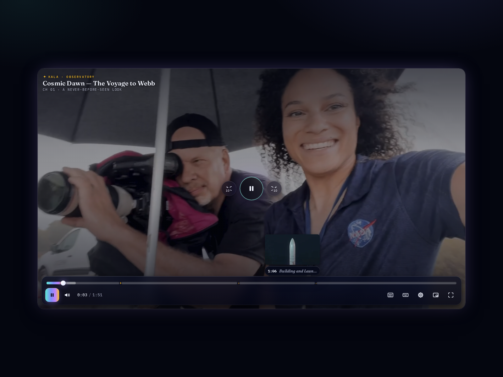

# KALA — An Observatory Player

A Video.js v10 skin for the videos you watch in the dark. Built for the
[Contra Video.js Skins Design Challenge](https://contra.com/community/topic/videojsskinschallenge).

**Live demo:** https://andipangeranm142.github.io/kala-videojs-skin/
**Player-only view:** https://andipangeranm142.github.io/kala-videojs-skin/preview.html



## The concept

*Kala* is Sanskrit & Indonesian for "time". Most players are neutral chrome;
Kala picks a niche — the night-sky film — and commits to it, so every detail
has a reason to exist:

- **The Night Arc** — the timeline is a horizon line: an aurora gradient fill,
  a glowing moon thumb, a buffered shimmer, and twinkling **chapter stars** at
  every chapter boundary. Hovering shows a live storyboard thumbnail, time,
  and chapter name.
- **The Eclipse** — the big play button is a glowing ring with a breathing
  halo while paused, flanked by ±10s seek buttons.
- **Three skies** — Midnight, Aurora, and Ember re-tint the whole player live
  (gradient, thumb glow, ambient light). The skin also honours the public
  `--media-accent-color` property.
- **A floating glass console** — backdrop blur, Fraunces serif title block
  with a live chapter line, a custom 18×18 "kala" SVG icon set, and an inline
  volume slider that unfurls from the mute button.
- **Full settings menu** — Quality (live HLS renditions), audio tracks,
  playback speed, and captions, with keyboard-navigable submenus.
- **Keyboard field guide** — press `?` for the shortcut map; 20+ shortcuts
  (play, seek, volume, fullscreen, PiP, captions, speed, jump-to-percentage).
- **Ambient glow** — the showcase page wraps the player in a blurred,
  light-reactive halo (toggleable).

## Accessibility

- Keyboard-operable everything, with a visible amber focus ring (dark halo so
  it reads on bright and dark frames alike).
- ARIA labels on every control, sliders exposing their values, and a live
  region announcing play, pause, seek, volume, and fullscreen changes.
- 44px touch targets, a tall seek hit-area, double-tap gestures.
- Tested against two videos — dark (*Cosmic Dawn*) and bright (*Daylight*,
  Earth from the ISS) — so the controls hold contrast over both.
- `prefers-reduced-motion`, high-contrast, and forced-colors support.

## Develop

```sh
npm run dev
```

Opens the showcase page. The workbench (the scaffold's preview shell) lives
at `/workbench.html`, and the player alone at `/preview.html`
(`#width=1360` sets the player width).

```sh
npm run typecheck   # tsc --noEmit
npm run build       # vite build -> dist/
```

`tools/` holds the Playwright verification scripts (they need the proxy
forwarder recipe — Chromium cannot use the sandbox egress proxy directly):

```sh
node tools/check.cjs http://localhost:4173 /tmp/kala-check            # player checks
node tools/check-showcase.cjs http://localhost:4173 /tmp/kala-showcase  # page checks
node tools/record-demo.cjs http://localhost:4173 /tmp/kala-media       # demo video + shots
```

## Where things live

- `src/` — the skin, and only the skin.
  - `src/video/skin.html` — the skin's markup (player structure + dialogs).
  - `src/video/skin.css` — all skin styling (~2,300 lines, layered).
  - `src/video/skin.ts` — skin setup + the Kala enhancements (keyboard
    dialog, live chapter label).
  - `src/video/icons.ts` — the custom "kala" SVG icon family.
  - `src/styles/` — theme tokens and the three skies.
- `apps/preview/` — the demo site.
  - `index.html` + `src/showcase/` — the showcase page.
  - `preview.html` + `src/frame/` — the player-only page.
  - `workbench.html` + `src/shell/` — the scaffold workbench (dev tool).
  - `src/media-config.ts` — **every video source lives here** (one file).
  - `public/footage/` — the Daylight MP4, posters, and chapters.
- `assets/submission/` — screenshots (1600×1200) + the demo video for the
  challenge form.
- `DESCRIPTION.md` — the design-thinking text for the submission form.

## Video sources

- **Cosmic Dawn — The Voyage to Webb** (default): NASA archival footage,
  streamed from Mux via the public playback ID the Video.js scaffold ships
  (`83EzHOvVzVN01AsrD01BCpiH02Pj3S8mfzBOu101w2nHC5s`). HLS renditions,
  chapters, auto captions.
- **Daylight — Earth from Space, Expedition 65**: NASA, public domain, cut
  from the Expedition 65 4K film. Served as a progressive MP4 from
  `public/footage/` — this is the clip to upload to Mux for the bonus point.

### Mux swap (one line)

1. Upload `apps/preview/public/footage/daylight-earth.mp4` to Mux as a public
   asset with static renditions enabled.
2. Paste its public playback ID into `MUX_PLAYBACK_ID` in
   `apps/preview/src/media-config.ts`.
3. Set `DEFAULT_FOOTAGE` to `'daylight-mux'` (or leave it — the footage
   switcher offers the Mux stream either way once configured).

## License

Apache 2.0 — see [LICENSE](LICENSE). Video.js is a registered trademark of
Brightcove Inc.; this skin is an independent entry and is not affiliated with
or endorsed by Video.js, Contra, or Mux.
